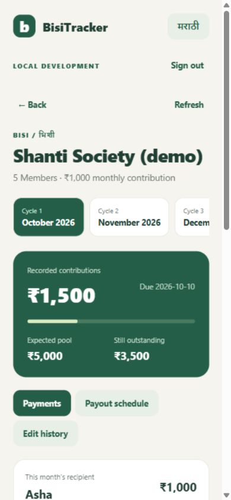
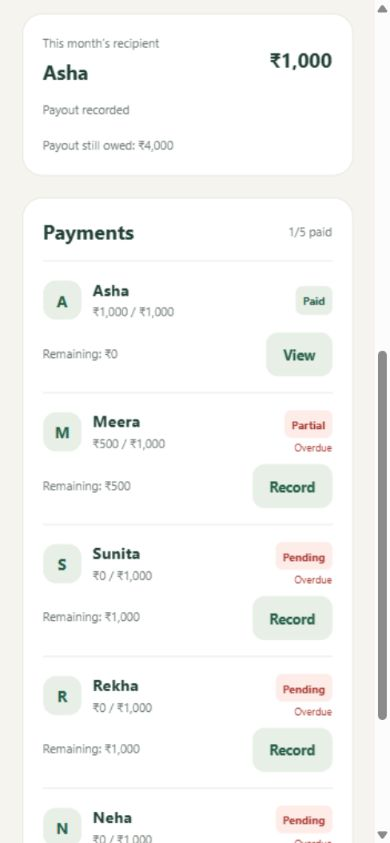
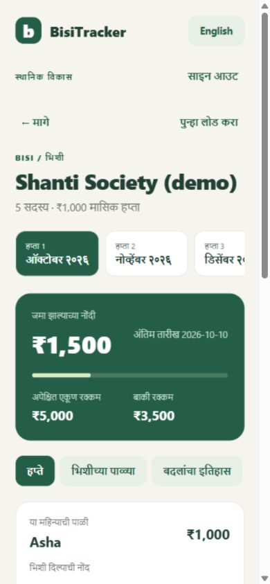

# BisiTracker

Organizer ledger for small, fixed-contribution monthly savings groups. Built with ASP.NET Core / .NET 10, PostgreSQL, and React Native / Expo with TypeScript.

The first local milestone is implemented. This is a development prototype, with an English/Marathi organizer workflow. It records payments and payouts made outside the app. It does not collect, hold, verify, or transfer money.

## Run locally

Requirements: .NET SDK 10 (see `global.json`), Node.js 24, npm, and Docker Desktop with Linux containers running. Commands below use PowerShell from the repository root.

Install JavaScript dependencies once:

```powershell
npm --prefix mobile ci
npm --prefix contracts ci
```

Start PostgreSQL and the API in terminal 1:

```powershell
.\scripts\dev-api.ps1
```

The API listens on `http://localhost:5080`. Development startup applies the checked-in EF migrations. Local PostgreSQL uses port 54329 and stores records in a Docker volume. The included database password is for local development only.

Start the browser preview in terminal 2:

```powershell
Set-Location mobile
npm run web
```

Open [the app preview](http://localhost:8081), choose the local development sign-in, and create a group. The demo identity is Asha. Records remain after restarting the API; tokens become invalid on an API restart, so sign in again. Browser preview credentials stay in memory and are cleared on a page reload. All sample records created during implementation are fictional.

For Android, use a development build with the Android SDK/emulator installed, or configure an EAS development build. No APK has been built or installed yet. `npm run android` starts Metro and opens an existing development client; it does not create that client. Follow the [Expo development build instructions](https://docs.expo.dev/develop/development-builds/create-a-build/).

Without an environment override, Android uses `http://10.0.2.2:5080`; web and the iOS simulator use `http://localhost:5080`. If using `mobile/.env.example`, change its API URL to match the device. A physical device needs a reachable development API address, a matching listen address, and appropriate local firewall access. Keep development authentication on a trusted development network.

## Implemented workflow

- Create a draft with contribution amount, first month, due day, and members in payout order; add more members while it is a draft.
- Activate the group to generate monthly cycles with one recipient per cycle. Membership and contribution rules then freeze.
- Record full or partial contributions with date, method, and an optional reference. View paid, partial, pending, and overdue states.
- Correct a payment by recording a reasoned reversal; the original entry remains in history.
- Record actual payouts in one or more installments. Expected pool, contributions received, payout recorded, and payout still owed stay distinct. Explain a funding gap if payouts exceed recorded contributions.
- Switch between English and Marathi, and inspect payment history and payout order.

Rules for this milestone: INR amounts are integer paise; monthly cycles; due day 1–28; 2–50 members on activation; one organizer; one slot per member. Entries cannot have a future payment date. Lucky draws, existing-group imports, and changing an active group's membership are deferred.

## Checks and API contracts

With local PostgreSQL running:

```powershell
.\scripts\check.ps1
```

This runs PostgreSQL-backed backend tests, mobile lint, TypeScript, and mobile unit tests. Integration tests create and remove their own randomly named databases, leaving the development ledger intact. For another test database server, set `BISI_TEST_DATABASE` to an administrative connection string with permission to create test databases.

Generate the contract from a running development API:

```powershell
.\scripts\update-contracts.ps1
```

The checked-in OpenAPI document lives in `contracts/openapi.json`; generated types live in `mobile/src/api/schema.d.ts`. Do not edit generated types by hand. The typed API client uses `openapi-fetch`.

Additional checks:

```powershell
dotnet list backend/BisiTracker.sln package --vulnerable --include-transitive
npm --prefix mobile audit
Set-Location mobile
npx expo-doctor
npm run export:android
```

The Android export produces JavaScript/assets, not an APK. The included GitHub Actions workflow runs on pushes and pull requests; check the repository's Actions tab for hosted results.

## Authentication and release configuration

The local sign-in endpoint exists only in Development and uses an ephemeral signing key. Production startup refuses development authentication. Organizer records are scoped to the validated token's issuer and subject; another organizer cannot read or modify them.

OIDC authorization-code sign-in with PKCE, token refresh, and native SecureStore support are implemented. A real identity provider has not been selected or tested. Before a release, register a public native client, authorize the app's callback URI (`bisitracker://oauth` for the native scheme; verify the actual URI for each build), and issue JWT access tokens for the backend audience. Never put a client secret in the mobile app.

Backend deployment needs:

- `ASPNETCORE_ENVIRONMENT=Production`
- `Authentication__DevelopmentEnabled=false`
- `Authentication__Authority` set to the provider's HTTPS issuer
- `Authentication__Audience` set to the API audience
- `ConnectionStrings__Database` supplied through deployment secrets
- `Database__MigrateOnStartup=false`; apply migrations as a reviewed deployment step
- Explicit CORS origins for any approved web client

Mobile release configuration is illustrated in `mobile/.env.example`. Use an HTTPS API URL and `EXPO_PUBLIC_AUTH_MODE=oidc`. Every `EXPO_PUBLIC_*` value is public build configuration. Configure a production HTTPS endpoint and trusted reverse proxy/forwarded-header behavior before deploying the API container. No production infrastructure is provisioned.

## Reliability and remaining work

Money calculations use integer paise. Writes, audit events, and operation IDs are committed together. Retrying the same operation and payload returns the original result; reusing its ID with a different payload fails. Group versions detect conflicting writes. Ledger reads use a consistent database snapshot.

The mobile app preserves an uncertain request for retry while that screen remains mounted. It does not yet persist requests across app restarts and has no offline ledger cache. A local Docker volume is persistence, not a backup. The app shows the latest 200 audit events; full history pagination is pending.

Production release still needs member sharing, durable offline storage, reminders, exports, backup/restore verification, account recovery and privacy workflows, device testing, pilot validation, and the regulatory review in the plan. See [implementation status](docs/IMPLEMENTATION_STATUS.md) and [phase plan](docs/IMPLEMENTATION_PLAN.md).

The 13 October 2026 mobile audit reports 28 affected packages (18 high, 10 moderate), propagated from `braces`, `node-forge`, `decode-uri-component`, and `uuid` through the Expo/React Native dependency tree. Compatible fixes available during this implementation were applied. Remaining advisories require an exposure assessment and compatible dependency updates before release. Do not use `npm audit fix --force` to replace the SDK with an incompatible version. The .NET scan reported no known vulnerable packages.

## Preview

Fictional local demo; no money was moved.






